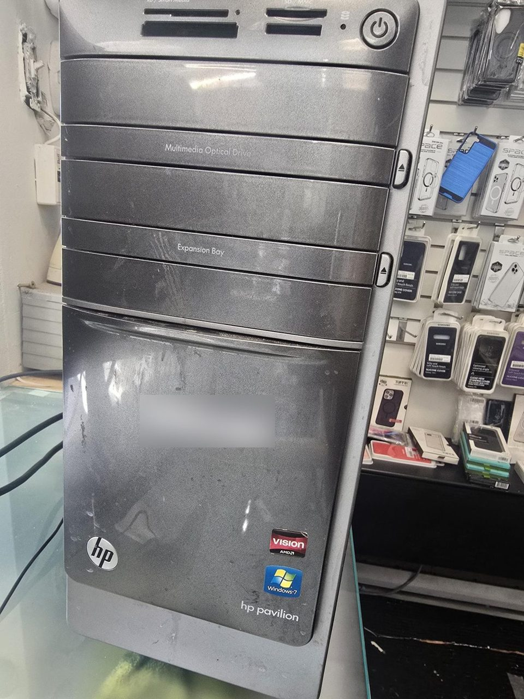
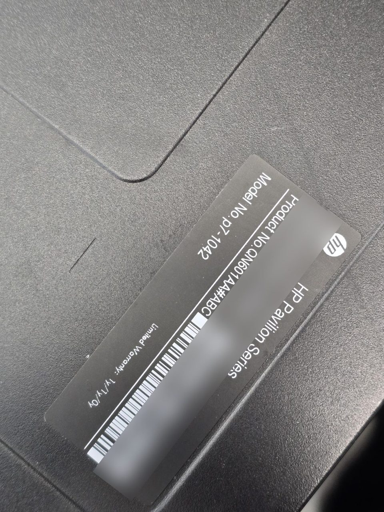
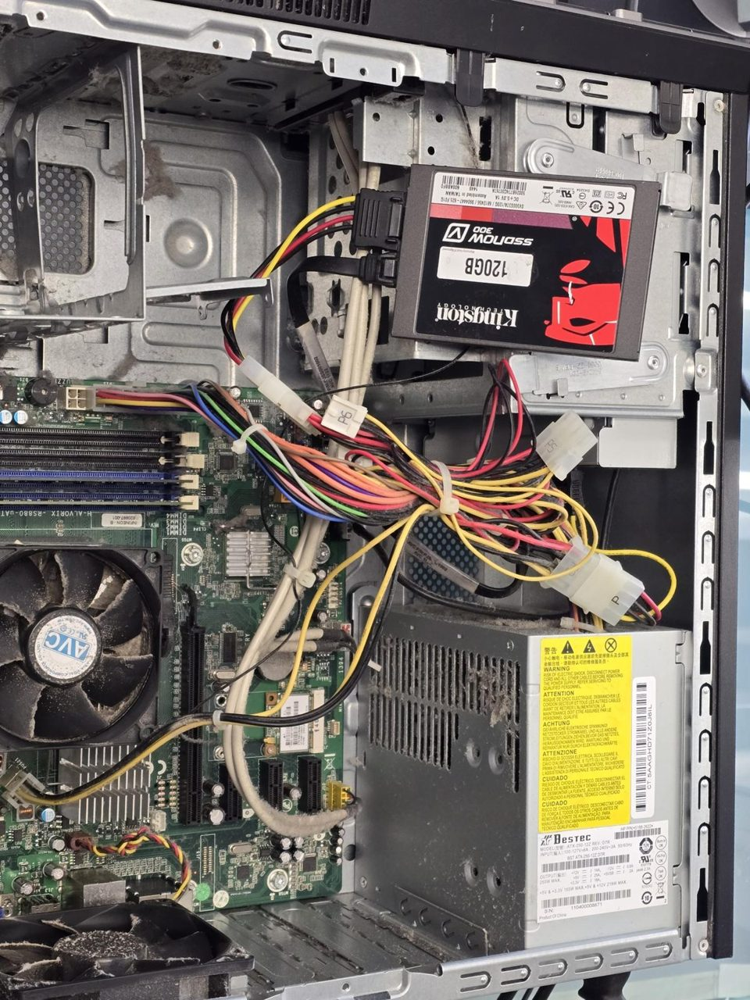

# Fiche 06 : HP Pavilion p7-1042, PC qui s'allume sans affichage

**Date :** octobre 2026 (semaine 1) · **Appareil :** tour HP Pavilion p7-1042 (AMD Vision, livrée sous Windows 7), alimentation Bestec 250 W · **Résultat :** En cours

| Façade | Étiquette du modèle | Intérieur avec le SSD installé |
|:---:|:---:|:---:|
|  |  |  |

## Symptôme

L'ordinateur démarre (ventilateurs et voyants actifs), mais rien ne s'affiche à l'écran.

## Tests effectués

1. Inspection des barrettes de RAM : retirées, vérifiées et remises en place
2. Installation d'un nouveau disque, un SSD Kingston SSDNow V300 de 120 Go

## Cause

Pas encore trouvée à la fin de la journée.

> Fiche mise à jour dès que la cause est confirmée.

---

[← Retour au journal](README.md)
