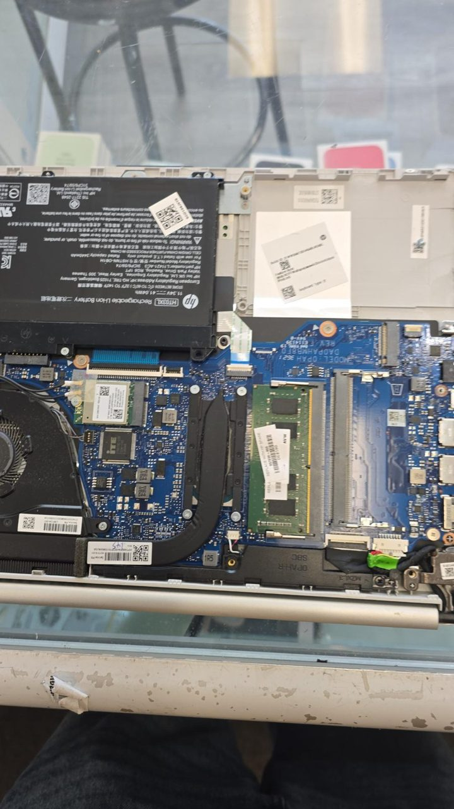

# Fiche 07 : portable HP dont le ventilateur ne tourne pas

**Date :** octobre 2026 (semaine 2) · **Appareil :** portable HP, carte mère DA0PAHMB8F0 · **Résultat :** En cours

<em>Carte mère DA0PAHMB8F0 : ventilateur à gauche, caloduc, barrette de RAM et carte Wi-Fi visibles.</em>

## Symptôme

Les voyants s'allument, mais le ventilateur reste immobile.

## Tests effectués

1. RAM retirée puis remise en place : aucun changement
2. Pile CMOS débranchée : aucun changement
3. Vérification de la fiche du ventilateur sur la carte mère

## Cause

Pas encore trouvée pendant la semaine.

> Fiche mise à jour dès que la cause est confirmée.

---

[← Retour au journal](README.md)
