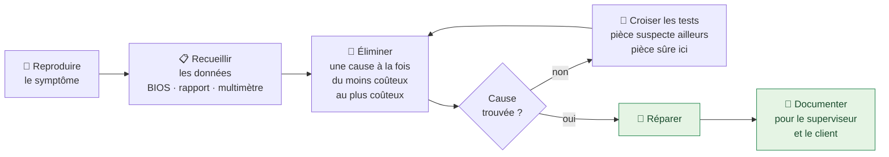

# Journal de dépannage

Fiches d'intervention tirées de mon stage de technicien informatique chez LaboPhone Inc., atelier de réparation (octobre – novembre 2026), dans le cadre du DEP Soutien informatique (ESIDEM, Montréal).

Chaque fiche suit le même ordre : **symptôme → tests → cause → solution → ce que j'en retiens**. Les informations des clients ne sont pas publiées.

  
  
  
  

📅 **[Déroulement du stage, semaine par semaine](stage.md)** : l'atelier en photos, toutes mes interventions et les compétences mises en pratique.

| Fiche | Appareil | Problème | Résultat |
| --- | --- | --- | --- |
| [01](01-acer-nitro5-ne-demarre-pas.md) | Acer Nitro 5 AN515-55 | Ne démarre pas, ventilateurs muets |  |
| [02](02-dell-optiplex-3020-windows11.md) | Dell OptiPlex 3020 | Mot de passe BIOS inconnu, installation de Windows 11 bloquée |  |
| [03](03-asus-cpu-fan-error.md) | PC Asus, carte P8H61-M PRO | Message « CPU FAN ERROR » |  |
| [04](04-portable-aucun-signe-de-vie.md) | Portable à deux SSD | Aucun voyant malgré 19 à 20 V au connecteur |  |
| [05](05-surface-pro-7-batterie.md) | Microsoft Surface Pro 7 | Batterie non détectée, arrêt dès qu'on débranche |  |
| [06](06-hp-pavilion-p7-1042-sans-affichage.md) | HP Pavilion p7-1042 (tour) | S'allume sans affichage |  |
| [07](07-hp-ventilateur-ne-tourne-pas.md) | Portable HP, carte DA0PAHMB8F0 | Voyants allumés, ventilateur immobile |  |

## Ma méthode

Modèle vierge : [MODELE-FICHE.md](MODELE-FICHE.md)
