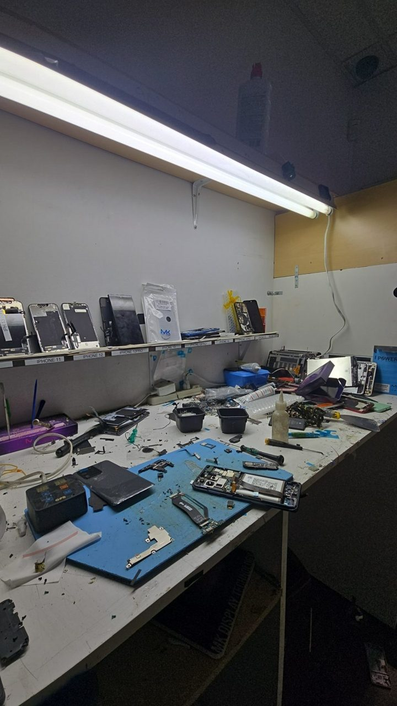
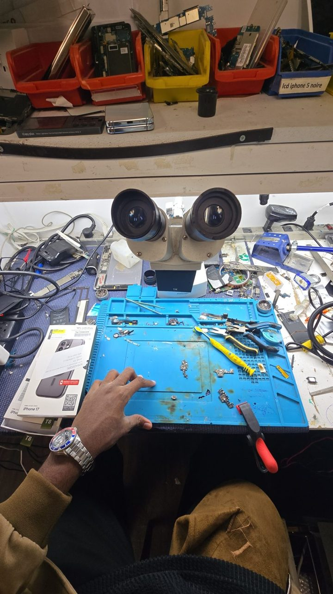
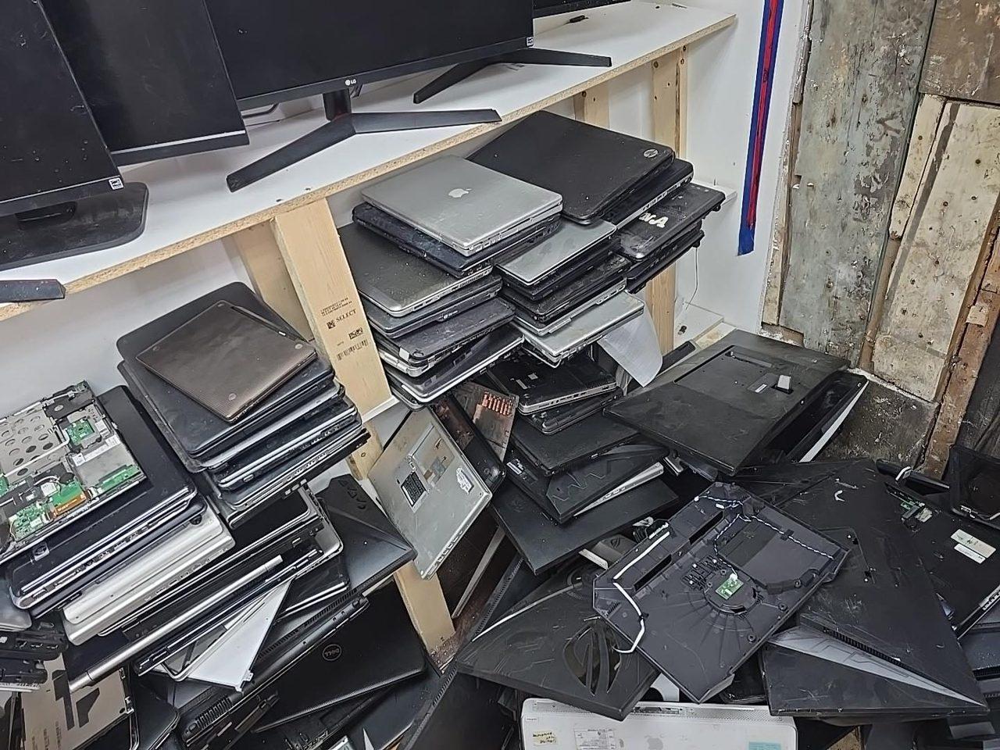

# Déroulement du stage chez LaboPhone Inc.

**Stagiaire :** Caleb Ebanda, finissant du DEP Soutien informatique (ESIDEM) · **Milieu :** LaboPhone Inc., boutique de réparation d'ordinateurs et de téléphones · **Début :** 15 octobre 2026

Chaque semaine fait aussi l'objet d'un rapport hebdomadaire de stage pour l'école.

## Le milieu de stage

| Établi de réparation de téléphones | Poste de microsoudure (microscope AmScope) | Stock de portables et d'écrans |
|:---:|:---:|:---:|
|  |  |  |

---

## Semaine 1

| Intervention | Rôle | Résultat |
|---|---|---|
| [HP Pavilion p7-1042 sans affichage](06-hp-pavilion-p7-1042-sans-affichage.md) | Diagnostic : RAM, installation d'un SSD Kingston 120 Go | En cours |
| Écran d'un Samsung Galaxy A | Assistance au technicien : démontage, observation du remplacement | Écran remplacé |
| Carte mère HP 250/255 G1 (LA-A996P) | Identification et annotation des composants | Terminé |
| Boutique | Réception et classement de la marchandise, accueil de 3 clients | — |

**Lecture d'une carte mère de portable.** Sur la carte LA-A996P / ZS051, j'ai repéré les ports audio, USB, RJ45 et HDMI, la pile CMOS, le lecteur SD, le slot RAM DDR3, les connecteurs SATA et du lecteur optique, le contrôleur clavier ENE KB9012 et le connecteur du ventilateur. Le slot Mini PCIe Wi-Fi et l'empreinte du GPU dédié avec ses deux puces VRAM sont vides : c'est normal sur une version à graphique intégré, dont l'APU est caché sous le dissipateur.

## Semaine 2

| Intervention | Rôle | Résultat |
|---|---|---|
| [Acer Nitro 5 qui ne s'allume pas](01-acer-nitro5-ne-demarre-pas.md) | Diagnostic complet, réinitialisation du BIOS | ✅ Réparé, ma première réparation |
| [Portable HP, ventilateur immobile](07-hp-ventilateur-ne-tourne-pas.md) | RAM, pile CMOS, fiche du ventilateur | En cours |
| Portable HP sans connecteur d'alimentation | Recherche de solutions pour recharger ou allumer l'appareil | En cours |
| [PC Asus « CPU FAN ERROR »](03-asus-cpu-fan-error.md) | Connecteurs, capteurs dans le BIOS | En attente d'un test croisé |
| [Portable sans signe de vie](04-portable-aucun-signe-de-vie.md) | Mesures au multimètre, continuité des cavaliers PJP | En cours |
| [Dell OptiPlex 3020](02-dell-optiplex-3020-windows11.md) | Mot de passe BIOS, installation de Windows 11 | ✅ Devenu poste de travail de la boutique |
| Boutique | Conseil d'achat, réception d'un portable Asus en réparation | — |

## Semaine 4

| Intervention | Rôle | Résultat |
|---|---|---|
| [Surface Pro 7, batterie non détectée](05-surface-pro-7-batterie.md) | Rapport de batterie, tests croisés, connecteur, carte mère | ✅ Réparé |

---

## Compétences mises en pratique

- **Diagnostic matériel** : configuration minimale, isolation des composants, tests croisés
- **Mesures électriques** : tension au multimètre, tests de continuité
- **BIOS et micrologiciel** : réinitialisation par la pile CMOS, cavalier PSWD, capteurs des ventilateurs
- **Systèmes d'exploitation** : installation de Windows 11 depuis une clé USB, contournement de la vérification TPM 2.0, compte local
- **Lecture de cartes mères** : identification des composants et des références
- **Téléphonie** : remplacement d'écran (assistance)
- **Boutique** : inventaire, service à la clientèle, réception des appareils
- **Documentation** : photos, fiches d'intervention, rapports hebdomadaires

---

[← Retour au journal](README.md)
